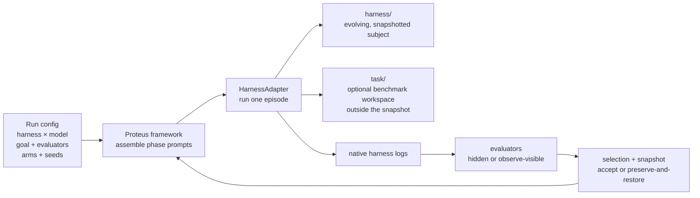

<p align="center">
  
</p>

<h3 align="center">A modular framework for agent self-improvement.</h3>

<p align="center">
  <b>Reusable methods. Explicit experiments. Inspectable results.</b>
</p>

<p align="center">
  <a href="https://github.com/proteus-evolve/Proteus/actions/workflows/ci.yml"></a>
  <a href="https://github.com/proteus-evolve/Proteus/actions/workflows/release-smoke.yml"></a>
  <a href="LICENSE"></a>
  
  
  
</p>

<p align="center">
  <b>Choose your harness. Start evolving.</b><br>
  A 15-second evolution trace. <a href="https://proteus-evolve.github.io/">Explore the interactive demo →</a>
</p>

https://github.com/user-attachments/assets/63311c1e-1ad9-4821-81b4-044cf5bf4650

<p align="center">
  <a href="#recipe-quick-start">Recipe Quick Start</a> •
  <a href="docs/V1_OVERVIEW.md">1.0 Architecture</a> •
  <a href="#method-families">Methods</a> •
  <a href="#-60-second-demo-no-api-key-no-docker">Native Demo</a> •
  <a href="#-harnesses-in-the-box">Harnesses</a> •
  <a href="docs/V1_OVERVIEW.md#architecture">How It Works</a> •
  <a href="docs/EPISODE.md">The Episode Loop</a> •
  <a href="docs/ADAPTERS.md">Onboard Your Harness</a> •
  <a href="docs/RECIPES.md">Recipes</a> •
  <a href="docs/plans/proteus-1.0.0-implementation-plan.md">1.0.0 Plan</a> •
  <a href="docs/BENCHMARKS.md">Bring a Benchmark</a> •
  <a href="docs/MEASUREMENTS.md">Add a Measurement</a> •
  <a href="docs/VISUALIZE.md">Visualize Runs</a> •
  <a href="docs/releases/v0.4.0.md">v0.4.0 Notes</a> •
  <a href="environments/README.md">Environments</a> •
  <a href="#-measurement">Measurement</a>
</p>

---

Proteus is developing a general framework for agent self-improvement research:
reproducible method recipes, reusable components, and shared execution, evaluation,
recovery and reporting infrastructure. The goal is an **ESPnet-style toolkit for
RSI research** where methods can be implemented, compared and extended in one place.

**1.0 is in development.** This source tree includes GEPA, ACE, Meta-Harness,
Combee and CORAL integrations with explicit profiles and deviations. Their
original-domain catalog entries still report `model_results_pending`. Runnable
mechanisms do not establish reproduced paper scores or recursive improvement.
The published `0.4.0` package and the native workflow remain available; the new
recipe commands below require the corresponding development checkout.

## Method families

| Family | Included profile | Study entry |
| --- | --- | --- |
| GEPA | Pinned single-mutation search, text components, instance frontier; no merge/cache | AIME baseline and optimized study |
| ACE | Playbook, three roles, offline/online update loops | Formula baseline and ACE |
| Meta-Harness | Historical code/evidence retrieval, multiple proposals, memory learning and final selection | Three pinned MCE datasets |
| Combee | Reusable parallel aggregation in ACE and GEPA; fixed/dynamic batches | Formula sequential/naive-parallel/Combee comparison |
| CORAL | One shared space, persistent workers, formal submissions and event interventions | Original 26-circle packing; one/two workers |
| Native | Existing harness evolution, goals/no-goal, feedback and surface measurements | Existing native CLI and compatibility recipe |

See the [support matrix and architecture](docs/V1_OVERVIEW.md) for exact boundaries,
reference links, shared modules and outstanding real-model acceptance.

Methods own their control flow. Typed stages and role-specific actors, immutable
candidates, task/subject/evaluator interfaces, search policies, parallel workflows
and persistent workers can be reused across them. Supported choices are configured
in a recipe; new mechanisms are added through plugins. Adding a self-evaluator is
an explicit method/stage composition, not an automatic change to every algorithm.

## Recipe quick start

Use a checkout containing the 1.0 development work. Keep the source and installed
package aligned, and put generated runs outside the checkout:

```bash
git clone --branch dev/1.0.0 https://github.com/proteus-evolve/Proteus.git
cd Proteus
python3 -m venv .venv
source .venv/bin/activate
python -m pip install -e .
proteus recipe catalog
```

The following example needs no model key, Docker or optional optimizer. It prepares
exact candidates, evaluates them and retains private final scores separately:

```bash
PROTEUS_EXAMPLE="$(mktemp -d)/comparison"
proteus recipe example candidate-comparison --out "$PROTEUS_EXAMPLE"
proteus recipe check "$PROTEUS_EXAMPLE/recipe.json"
proteus recipe lock "$PROTEUS_EXAMPLE/recipe.json" \
    --source "proteus=$PWD" --out "$PROTEUS_EXAMPLE/lock.json"
proteus recipe run "$PROTEUS_EXAMPLE/recipe.json" \
    --lock "$PROTEUS_EXAMPLE/lock.json" \
    --artifact-store "$PROTEUS_EXAMPLE/artifact-store" --out "$PROTEUS_EXAMPLE/run"
proteus recipe resume "$PROTEUS_EXAMPLE/recipe.json" \
    --lock "$PROTEUS_EXAMPLE/lock.json" --out "$PROTEUS_EXAMPLE/run"
proteus recipe export "$PROTEUS_EXAMPLE/run" --out "$PROTEUS_EXAMPLE/export"
```

`export/report.json` and eight CSV files contain task/cohort records, candidate
lineage, role/stage costs, attempts and controller intervals. Hidden final scores
require a separate owner-side export with `--include-private`. A completed resume
does not repeat formal trials; interrupted external work uses its declared recovery
protocol. This deterministic example checks infrastructure, not model quality.

To extend a method, start with [editable plugin templates](docs/V1_PLUGIN_SCAFFOLDS.md),
the [versioned API](docs/V1_PUBLIC_API.md), and the [search-policy tutorial](docs/V1_RECIPE_CATALOG.md).
For experiments, use the catalog's original-domain instructions and
[StudySpec comparisons](docs/V1_STUDY_COMPARISON.md). Read the
[compatibility rules](docs/V1_COMPATIBILITY.md) before resuming an older run.

The native workflow below continues to provide source-evolving harness adapters,
configurable episodes, goals and surface-specific measurements.

## 🚀 60-second demo (no API key, no Docker)

For the published native release, use a separate environment from the development
checkout above:

```bash
pip install proteus-evolve==0.4.0  # no model SDK; Python 3.10 adds only a TOML compatibility package
```

The bundled `minimal` harness runs fully offline, so you can see the whole pipeline before
wiring up a real agent:

```bash
proteus run --harness minimal \
    --arm neutral --arm review:notes --arm review:tools \
    --seeds 4 --episodes 8 --out runs/demo
proteus measure --harness minimal --out runs/demo
proteus visualize --out runs/demo  # local UI: http://127.0.0.1:8301
```

```
arm              seeds       notes       tools   (mean units built)
neutral              4         3.5         4.0
review_notes         4        13.0         0.0
review_tools         4         3.8         8.0

behavioural R (between/within arms, last episode): 3.075  p=0.0150
```

An installed action preference measurably shifts what the harness grows — and the same
`measure` reads a no-goal run and a goal run identically.

**Proteus Visualize** opens existing sweeps with looping replay, episode details,
snapshot/candidate identities, and the same structural and behavioral instruments.
Viewing makes no model calls; explicit CLI-backed launches are opt-in. See
[`docs/VISUALIZE.md`](docs/VISUALIZE.md) for configuration, evidence and export boundaries.

## 🧩 Harnesses in the box

| adapter | what it is | needs |
|---|---|---|
| `minimal` | offline reference harness (mock policy) | nothing |
| `llm` | the same harness driven by a live model — any OpenAI-compatible endpoint, DeepSeek by default | an API key |
| `dsh` | [DeepSeek Harness](https://github.com/deepseek-ai/deepseek-harness), headless profile, in a prepared container | Docker + a DeepSeek key |
| `pi` | [Pi](https://github.com/badlogic/pi-mono) — Mario Zechner's minimal coding harness (4 tools, native AGENTS.md + skills) | Docker + a DeepSeek key |
| `codex` | [OpenAI Codex CLI](https://github.com/openai/codex) — pinned, source-evolving Rust harness using native `codex exec --json` traces | Docker + Codex auth/API key |
| `aki` | the Aki research harness (the paper's apparatus) | the research checkout |
| yours | `--harness <module>:<Class>` — no registration | your adapter |

`dsh`, `pi`, and `codex` are the source-evolving third-party integrations. At seed time each
adapter extracts the pinned harness's real source into `harness/src/`. During episode N,
all four phases boot the same read-only last-valid snapshot while writing a separate
candidate. After reflect, Proteus rebuilds and validates the candidate; only a passing
candidate activates in episode N+1. A failed build is prevented from activating, while
its exact tree is restored as the next writable repair candidate; the next episode's
running harness remains healthy. The source is therefore a
measured, snapshotted `loop` surface alongside instructions, notes, tools, and skills. The
adapters still leave the upstream repositories untouched: they arrange the run copy,
launch one prepared container per phase, and parse the harness's own session logs.

## 🏗️ How the native episode workflow works



Every seed runs `N` context-fresh **episodes**. Evolved harness files cross the episode
boundary; adapters that opt into framework continuity also receive a bounded operational
handoff stored outside the measured snapshot. By default, one episode is four phases:

```
observe  →  propose  →  act  →  reflect
```

- **observe** — take stock; if you configured a *visible* evaluator, its score on the last
  episode is shown here.
- **propose** — list ways to improve your own harness.
- **act** — carry one out by editing the harness. The goal, if any, is announced in every
  fresh phase so observation and planning stay aligned with it.
- **reflect** — decide what to keep.

The **framework** owns everything that is not the harness (prompts, goal text, evaluator
routing, snapshotting, selection, measurement). The **adapter** owns everything that is
(how the four phases actually execute). That split is what makes Proteus harness-agnostic.

### The core objects

| Concept | What it is |
|---|---|
| `HarnessAdapter` | the contract a harness implements: its surfaces, phase-continuity capability, how to run an episode, how to read the action trace, how to install/remove a disposition |
| `Surface` | one editable, persistent region (memory / skills / tools / code / …), declared as data so the measurement layer needs no hard-coded names |
| `Disposition` | the action-preference perturbation — a **single, removable** change at t=0 (prompt suffix, config value, or code patch) |
| `GoalConfig` | goal / no-goal / multi-goal, each evaluator `HIDDEN` or `OBSERVE`-visible, plus outer-loop selection (`accept_reject`) |
| `Sandbox` | where an episode runs; `LocalSandbox` (trusted) or `DockerSandbox` (OS-level isolation, tunable network) |

### Action preference

An action preference is installed as a `Disposition` and is guaranteed **removable**, so the
crystallization test can take it away and read what the harness built on its own:

```python
from proteus.core import review, record, NEUTRAL
review("memory")     # each phase: review your memory, act or not
record("tools")      # keep your tools current as you work
NEUTRAL              # the control, F0 — no perturbation
```

### Goals and evaluators

```python
from proteus.core import EvaluatorSpec, GoalConfig, Visibility

GoalConfig.no_goal()                                    # unpressured evolution
GoalConfig.of(text="Become more reliable.")             # stated goal, no evaluator
GoalConfig.of(
    text="Become more reliable.",
    evaluators=(EvaluatorSpec("reliability", my_eval,
                              visibility=Visibility.OBSERVE),),
)                                                       # agent sees the score next episode
GoalConfig.of(text="Pursue A and B together.",
              evaluators=(EvaluatorSpec("a", eval_a),
                          EvaluatorSpec("b", eval_b)),
              selection="accept_reject")               # outer loop rejects regressions
```

An evaluator is any callable `(trace, ctx) -> EvalResult`; bring a benchmark verifier, an
LLM judge, or one of the built-ins (`proteus.core.evaluators`).

Evaluator visibility, selection eligibility, and scheduling are independent. You can
evaluate H0, every N episodes, or explicit checkpoints while retaining dated feedback
across fresh contexts. See [evaluator controls](docs/BENCHMARKS.md#evaluator-roles-schedules-and-feedback).
The default four-phase protocol can also be customized; DSH supports explicit
interrupted-phase recovery without refilling the tool budget. See [episode controls](docs/EPISODE.md).

### Sandbox

```python
from proteus.sandbox import SandboxConfig, DockerSandbox
DockerSandbox(SandboxConfig(network="none"))    # no egress
DockerSandbox(SandboxConfig(network="host",     # needs an LLM endpoint
                            env_passthrough=("OPENAI_API_KEY",),
                            mem_limit="4g"))
```

A self-editing agent writes and runs its own code, so an application-level file sandbox
cannot contain it — Proteus runs real harnesses in a container whose filesystem holds the
harness and nothing else.

## 🔌 Onboard your harness

The input is a **repository** — a git URL or local path:

```bash
proteus env scaffold --from https://github.com/org/their-harness --name theirs --ref v1.2.0
proteus env build theirs             # pinned image, resolved sha recorded in the manifest
# write the adapter (7 methods), then:
proteus check --harness mypkg.theirs_adapter:TheirsHarness --episode
proteus run   --harness mypkg.theirs_adapter:TheirsHarness --arm neutral ...
```

`proteus check` machine-verifies the contract (removable disposition via fingerprint
round-trip, snapshot-ability, trace shape). The full guide: [docs/ADAPTERS.md](docs/ADAPTERS.md).
To start from a working skeleton instead of a blank file,
`python -m proteus.scaffold adapter MyHarness` copies the fully-commented
[proteus/examples/adapter_template.py](proteus/examples/adapter_template.py) — see
[CONTRIBUTING.md](CONTRIBUTING.md). The templates ship on PyPI too; outside a Git checkout
the default output is the current directory (or choose an explicit `--dest`).

## 📦 Prepared environments

`environments/` contains two environment shapes. Manifest-backed environments pair a
`Dockerfile` or prebuilt image with `environment.toml`; the built-in `dsh-src/` and
`pi-src/` images are instead built from pinned upstream source checkouts, because the image
must contain the exact source and toolchain that the adapter later extracts and rebuilds.
In both shapes evolving state lives in mounts, never in a per-run image. Conventions:
[environments/README.md](environments/README.md); design notes:
[docs/ENVIRONMENTS.md](docs/ENVIRONMENTS.md).

## 📏 Measurement

```python
from proteus.measure import distance, stream, crystallize
```

- `distance` — structural distance per surface (added / dropped / revised), path length
  (`proteus measure --travel`).
- `stream` — behavioural distance (frequency / order / procedure) and the between/within
  permutation test `R`.
- `crystallize` — mount an evolved state under a neutral disposition and test whether it
  reads back as its own endpoint (two-stage fidelity + arm-shift).

To add a per-episode measurement evaluator, a post-run statistic, or an adapter-native
counter, see [docs/MEASUREMENTS.md](docs/MEASUREMENTS.md). The guide covers their different
contracts, artifact boundaries, CLI/report integration, statistical rules, and tests.

## 📤 Outputs

Every run's primary artifact is its **evolution history as a git repository** — one commit
per episode. Keep it local, browse it, or push it wherever you like (never automatic):

```bash
proteus repo export runs/demo/runs/run-<id> my-evolution   # normal repo, `git log` = the trajectory
proteus repo push   runs/demo/runs/run-<id> git@github.com:you/my-evolution.git
```

Every sweep also ships a **live tracking page** — per-run progress, per-surface growth
curves, evaluator scores — updating while the sweep runs:

```bash
proteus watch --out runs/demo          # http://localhost:8300/report.html
```

Tracking data (condition labels, hidden scores) lives at the sweep level, outside run
roots, so the evolving agent can never read its own condition.

## 📊 Status

The released native workflow remains `v0.4.0` (research preview); see its
[release notes](docs/releases/v0.4.0.md). The 1.0 development line adds shared method
recipes and researcher interfaces. [Unreleased 1.0 notes](docs/releases/v1.0.0.md)
describe the current implementation and remaining acceptance.

CI covers Python 3.10–3.14, installed wheel/sdist examples and pinned reference
contracts. Harbor gates execute real Docker trials; the separate live release-smoke
workflow covers minimal, LLM, Pi, DSH and Codex. These checks supplement the five
families' required real-model studies. They do not replace those results.

Work is integrated through feature PRs into `dev/1.0.0`. Final acceptance and main
review precede a version change, release tag and publication. The full scope remains
in the [1.0 implementation plan](docs/plans/proteus-1.0.0-implementation-plan.md).

## 🤝 Contributing

For the 1.0 framework, add a method, stage, evaluator, subject or search policy
through the [plugin templates](docs/V1_PLUGIN_SCAFFOLDS.md), preserving managed
execution and evidence. Use source/version locks and include mechanism, recovery
and installed-package checks.

Native **harness adapters** and **benchmarks** continue to use these scaffolds:

```bash
python -m proteus.scaffold adapter MyHarness    # skeleton -> proteus/adapters/myharness.py
python -m proteus.scaffold benchmark my_task    # skeleton -> proteus/bench/my_task.py
proteus check --harness proteus.adapters.myharness:MyHarness --episode
```

The step-by-step guide (contract, templates, the conformance gate in
`tests/test_conformance.py`, PR expectations) is [CONTRIBUTING.md](CONTRIBUTING.md).

Where help is wanted, in one line each — the full list with difficulty tags is
[ROADMAP.md](ROADMAP.md):

- **More harnesses** — Hermes Agent first (Python, built-in self-improvement surfaces),
  then SWE-agent, OpenClaw, OpenHands, OpenCode, Goose.
- **More benchmarks** — BigCodeBench-lite and a LiveCodeBench subset, SWE-bench
  Lite/Verified wiring, and finishing sandboxed grading for `swe` (HumanEval and MBPP
  are shipped).
- **Analysis** — `proteus compare` for side-by-side arms/runs; an episode-atlas view.
- **Reproducibility & cost** — per-episode token/cost accounting; one-command reproduce.

## 📖 Citation

See [CITATION.cff](CITATION.cff). A paper reference will be added when the preprint is
public.

## License

MIT.
