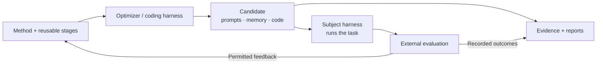

<p align="center">
  
</p>

<h3 align="center">Harness-agnostic agent self-improvement.</h3>

<p align="center">
  <b>Bring your harness. Compose the method. Evaluate and visualize the evolution.</b>
</p>

<p align="center">
  <a href="https://github.com/proteus-evolve/Proteus/actions/workflows/ci.yml"></a>
  <a href="https://github.com/proteus-evolve/Proteus/actions/workflows/release-smoke.yml"></a>
  <a href="LICENSE"></a>
  
  
</p>

<p align="center">
  <a href="#use-proteus-with-your-agent">Agent Skills</a> •
  <a href="#recipe-quick-start">Quick Start</a> •
  <a href="#harness-agnostic-by-design">Harnesses</a> •
  <a href="#method-families">Methods & Composition</a> •
  <a href="#evaluation-as-part-of-the-experiment">Evaluators</a> •
  <a href="#visualize-the-evolution">Visualization</a> •
  <a href="recipes/README.md">Experiments</a> •
  <a href="#documentation">Docs</a>
</p>

---

**Proteus is a modular framework for building and studying self-improving agents.**
Optimize prompts, memory, skills or harness source code while keeping the optimization
method, agent runtime and evaluation protocol independently configurable.

- **Harness-agnostic:** use Pi, DeepSeek Harness, Codex, an HTTP model adapter, or
  your own integration in supported roles. The agent proposing changes and the
  agent executing the candidate can use different harnesses and models.
- **Composable methods:** reuse stages, search policies, parallel aggregation and
  worker infrastructure. Included combinations span Combee + ACE, Combee + GEPA,
  and explicit self-evaluation stages.
- **Flexible evaluation:** combine task verifiers, model judges, visible feedback,
  hidden tests and agent self-assessment, with explicit control over which evidence
  can guide the next update.
- **Visual evolution:** replay Native sweeps, compare trajectories, inspect candidate
  changes and evaluator scores, and export recipe results for further analysis.

> **1.0 is in release preparation, not published yet.** The quick start below uses
> the preparation branch. Release status and the published Native workflow are
> tracked in the [release notes](docs/releases/v1.0.0.md) and
> [GitHub releases](https://github.com/proteus-evolve/Proteus/releases).

<p align="center">
  <b>Watch a Native evolution replay.</b><br>
  <a href="https://proteus-evolve.github.io/">Explore the interactive demo →</a>
</p>

https://github.com/user-attachments/assets/63311c1e-1ad9-4821-81b4-044cf5bf4650

## Use Proteus with your agent

Give your coding agent the goal; let it configure the harnesses, method and evaluators,
run the experiment, then explain the evidence. Proteus includes two companion
**Agent Skills** in this repository:

| Skill | Use it to |
| --- | --- |
| [`proteus-use`](skills/proteus-use/SKILL.md) | Choose or compose a method, bind harness roles, configure evaluation, run/resume experiments, export results and visualize Native sweeps |
| [`proteus-contribute`](skills/proteus-contribute/SKILL.md) | Extend methods, stages, harnesses, evaluators and other framework components through the public contracts; validate and prepare a contribution |

The contribution skill is **optional guidance**, not a requirement for submitting
a PR. Both skills use `SKILL.md` instructions, with optional Codex display metadata;
the workflows are not tied to Codex as the experiment's harness.

### Install and invoke a skill

In Codex, ask the built-in skill installer to install the usage skill from this
preparation branch:

```text
$skill-installer install the skill at skills/proteus-use from
proteus-evolve/Proteus, ref codex/v1-final-acceptance-20261101.
```

For framework development, install `skills/proteus-contribute` the same way.
After installation, select the skill or invoke it by name. See the
[Codex skill documentation](https://learn.chatgpt.com/docs/build-skills) for local
discovery and installation behavior.

With another agent, copy the selected skill folder into that agent's supported
skills directory. An agent that can read files and run shell commands can also
read `skills/proteus-use/SKILL.md` directly from a Proteus checkout. The skills
are distributed through Git, separately from the Python wheel; use the same
tag or commit as your Proteus checkout. Install the Python package using the
[quick start](#recipe-quick-start) below, or ask your agent to do so.

Try this first:

```text
Use $proteus-use to set up Proteus and run its offline candidate-comparison
example. Check recovery, export the results, then create a small Native demo
and open the visualization. Use no API calls or Docker.
```

For an experiment with your own agent:

```text
Use $proteus-use to improve my harness on the attached tasks. Compare Native
self-evolution with a compatible method using a separate coding proposer.
Keep the same visible/hidden split and external evaluator, explain which
combinations are supported, and prepare a minimal pilot for each. Show me
the exact recipes and resource estimates before starting paid runs.
```

For a contribution:

```text
Use $proteus-contribute to add a typed self-evaluation stage as an external
plugin. Demonstrate that a later stage consumes its output, keep the external
task score separate, and run the scaffold's offline checks.
```

## Recipe quick start

Install the 1.0 preparation checkout with Python 3.10 or newer:

```bash
git clone --branch codex/v1-final-acceptance-20261101 https://github.com/proteus-evolve/Proteus.git
cd Proteus
python3 -m venv .venv
source .venv/bin/activate
python -m pip install -e .
proteus recipe catalog
```

Run an offline candidate-comparison recipe. It needs **no API key or Docker**:

```bash
PROTEUS_EXAMPLE="$(mktemp -d)/comparison"
proteus recipe example candidate-comparison --out "$PROTEUS_EXAMPLE"
proteus recipe check "$PROTEUS_EXAMPLE/recipe.json"
proteus recipe lock "$PROTEUS_EXAMPLE/recipe.json" \
    --source "proteus=$PWD" --out "$PROTEUS_EXAMPLE/lock.json"
proteus recipe run "$PROTEUS_EXAMPLE/recipe.json" \
    --lock "$PROTEUS_EXAMPLE/lock.json" \
    --artifact-store "$PROTEUS_EXAMPLE/artifact-store" --out "$PROTEUS_EXAMPLE/run"
proteus recipe resume "$PROTEUS_EXAMPLE/recipe.json" \
    --lock "$PROTEUS_EXAMPLE/lock.json" --out "$PROTEUS_EXAMPLE/run"
proteus recipe export "$PROTEUS_EXAMPLE/run" --out "$PROTEUS_EXAMPLE/export"
```

This creates two immutable, fixed candidates, evaluates each and exports
`report.json` plus eight CSV tables. The completed resume reuses settled
work. Private test scores require an owner-side export with `--include-private`.
This offline fixture demonstrates the pipeline; it is not a model improvement
result. The separate [search-policy example](docs/V1_RECIPE_CATALOG.md#replace-a-final-selector-without-changing-the-engine)
demonstrates candidate selection. See the [catalog](docs/V1_RECIPE_CATALOG.md) for
method examples and benchmark preparation instructions.

To try the interactive viewer, generate a small **Native sweep** in the same environment:

```bash
PROTEUS_NATIVE="$(mktemp -d)/native-demo"
proteus run --harness minimal --arm neutral --arm review:notes \
    --episodes 8 --seeds 2 --evaluator tool-calls@observe \
    --eval-initial tool-calls --out "$PROTEUS_NATIVE"
proteus visualize --out "$PROTEUS_NATIVE"
# Open http://127.0.0.1:8301
```

The `minimal` harness is a deterministic offline policy. Its snapshots, evaluator
records and visualized trajectories are real outputs of that fixture.

## Harness-agnostic by design

A method defines **how to improve**. A harness supplies **how an agent runs**.
A candidate is **what changes**: text components, a playbook, memory or source files.
The subject runner executes that candidate on a task; the evaluator grades its output.



Bind optimizer, subject and model-grader roles separately in a recipe. Native
self-evolution can use the same harness integration to propose changes and run the
evolving candidate. Another setup can use a coding harness to modify a candidate
that a different subject executes.

| Integration | Available use | Setup |
| --- | --- | --- |
| [Pi](https://github.com/badlogic/pi-mono) | Agent/coding roles and staged source evolution | Prepared Docker image + model credentials |
| [DeepSeek Harness](https://github.com/deepseek-ai/deepseek-harness) | Agent/coding roles and staged source evolution | Prepared Docker image + model credentials |
| [Codex](https://github.com/openai/codex) | Agent/coding roles and staged source evolution | Pinned Rust Docker image + Codex authentication |
| `llm` | HTTP model actor, candidate execution and file evolution | Compatible model endpoint + credentials |
| `minimal` | Offline Native demo and fixture actor | No API key or Docker |
| Your harness | Roles advertised by your adapter and integration | [Register an integration](docs/V1_HARNESS_ROLES.md#integration-and-configuration) |

Registration declares roles and capabilities once; methods use those contracts
rather than a separate implementation for every harness pair. Candidate formats and
method protocols still have to match. The [role and evidence matrix](docs/V1_HARNESS_ROLES.md#capability-and-evidence-matrix)
documents supported combinations and 16 bounded live pilot cells; it is not a claim
that every method × harness × role combination has been tested.

For source evolution, all phases execute the last-valid harness while editing a
separate candidate. Proteus validates the candidate before activating it in the
next episode, retaining a failed candidate for repair. See the
[Native evolution profile](docs/V1_HARNESS_ROLES.md#native-evolution-with-external-evaluation)
and [adapter guide](docs/ADAPTERS.md). The existing Native CLI, including the Aki
research adapter, remains available through its [compatibility path](docs/V1_COMPATIBILITY.md).

## Method families

Proteus includes the following method profiles and their original-domain recipes.
Each profile records the upstream source and its supported options.

| Method | What it provides | Recipe / implementation | Original work |
| --- | --- | --- | --- |
| **GEPA** | Reflective evolution of text components and candidate selection | [AIME](recipes/gepa/aime/README.md) · [method](docs/V1_GEPA_METHOD.md) | [Paper](https://arxiv.org/abs/2507.19457v2) · [Code](https://github.com/gepa-ai/gepa) |
| **ACE** | Playbook updates through generator, reflector and curator roles; offline and online learning | [Formula](recipes/ace/formula/README.md) · [method](docs/V1_ACE_METHOD.md) | [Paper](https://arxiv.org/abs/2510.04618v3) · [Code](https://github.com/ace-agent/ace) |
| **Meta-Harness** | Candidate-code proposals, historical evidence retrieval and memory learning | [MCE](recipes/meta-harness/mce/README.md) · [method](docs/V1_META_HARNESS.md) | [Paper](https://arxiv.org/abs/2603.28052v1) · [Code](https://github.com/stanford-iris-lab/meta-harness) |
| **Combee** | Parallel learning and aggregation for ACE and GEPA, with fixed or dynamic batches | [Formula](recipes/combee/formula/README.md) · [ACE](docs/V1_COMBEE_ACE.md) / [GEPA](docs/V1_COMBEE_GEPA.md) | [Paper](https://arxiv.org/abs/2604.04247v2) · [Code](https://github.com/gepa-ai/gepa) |
| **CORAL** | Persistent research workers, shared knowledge, formal submissions and event-driven interventions | [Circle packing](recipes/coral/circle-packing/README.md) · [method](docs/V1_CORAL_METHOD.md) | [Paper](https://arxiv.org/abs/2604.01658v3) · [Code](https://github.com/Human-Agent-Society/CORAL) |
| **Native** | Harness self-evolution with candidate validation and next-episode activation | [Shared external evaluation](recipes/native/shared-evaluation/README.md) · [episode protocol](docs/EPISODE.md) | [Native Pi experiment and software credit](recipes/native/pi/README.md) |

### Compose the experiment

Composition is about reusing mechanisms as well as choosing a named method:

- **ACE + Combee:** learn from samples in parallel, then aggregate their updates
  into a shared playbook. Compare sequential, naive parallel, fixed-batch and
  dynamic-batch settings in the [Formula recipes](recipes/combee/formula/README.md).
- **GEPA + Combee:** reuse parallel proposal aggregation within the GEPA profile;
  configure its batch policy and evaluation through the
  [Combee–GEPA integration](docs/V1_COMBEE_GEPA.md).
- **Proposal + self-evaluation:** connect a typed proposal stage to a self-evaluator
  and specify how later stages consume its assessment. The
  [offline stage example](recipes/examples/self-evaluation.toml) demonstrates the
  wiring; [plugin templates](docs/V1_PLUGIN_SCAFFOLDS.md) show how to implement it.
- **Search-policy ablations:** swap a supported parent, archive or final-selection
  policy while keeping candidates and evaluation fixed. The
  [runnable selector example](docs/V1_RECIPE_CATALOG.md#replace-a-final-selector-without-changing-the-engine)
  changes the selected candidate through configuration alone.

Methods retain their own control flow. Adding a stage does not silently change
every algorithm: a composing method must invoke it. New update rules and loops
use the [versioned plugin API](docs/V1_PUBLIC_API.md), with shared artifact,
evaluation, budget and recovery services.

## Evaluation as part of the experiment

Choose the evaluator independently of the optimization method and subject harness.
Proteus supports deterministic task scoring, benchmark verifiers, private
Harbor/Docker graders, managed model judges and custom evaluator plugins.

| Evaluation role | Purpose | How the evidence is used |
| --- | --- | --- |
| **Visible external evaluation** | Measure the candidate against declared tasks | Release permitted scores, feedback or traces to guide later updates |
| **Hidden external evaluation** | Audit generalization on held-out tasks | Keep private grades outside optimizer/subject feedback; owner-side reporting is explicit |
| **Self-evaluation stage** | Let the agent assess its own proposal or candidate | Produce separate stage evidence that the method can consume |
| **Structural and behavioral measurements** | Track what changed in the candidate or action trajectory | Describe evolution alongside task scores |

An agent's self-assessment does not become the external benchmark score. Recipes
bind task splits, evaluator identities and evidence permissions; model grading
can use its own harness/model role and usage accounting. Native episodes also
support H0 evaluation, cadence and explicit checkpoints, with visibility,
selection eligibility and scheduling configured independently.

Start with [benchmark and evaluator controls](docs/BENCHMARKS.md),
[independent model grading](docs/V1_HARNESS_ROLES.md#external-evaluators-and-private-model-grading),
or the [custom evaluator template](docs/V1_PLUGIN_SCAFFOLDS.md).
Native additionally supports goal-free, single-goal and multi-goal conditions through
[`GoalConfig`](docs/EPISODE.md).

## Visualize the evolution

**Proteus Visualize** is a local workspace for inspecting Native sweeps as they run
or replaying completed experiments. It ships with the Python package and opens
without a frontend build or model call:

```bash
proteus visualize --out /path/to/native-sweep
```

- **Evolution:** replay trajectories, compare recorded runs, and switch between
  evaluator scores, structural displacement and tool-frequency divergence.
- **Measurements:** inspect surface changes, path length and behavioral distances;
  compare matched seeds when the measurement requirements are satisfied.
- **Configuration:** inspect recorded goals, harness/model settings, budgets,
  phases and evaluator visibility; compose a new Native run configuration.
- **Snapshots:** inspect valid checkpoints and proposed candidates, including
  rejected edits, without confusing a proposed change with an activated one.

The viewer is read-only by default. Run launching is an explicit opt-in, and hidden
scores are available to the local owner without feeding them back to the agent.
See the [viewer guide](docs/VISUALIZE.md) for configuration and export controls.

For **general method recipes**, use [JSON/CSV export](docs/V1_RESULT_EXPORT.md) and
[study comparisons](docs/V1_STUDY_COMPARISON.md) to analyze task scores, candidate
lineage, role/stage usage, failures and measured timing. Supported candidate formats
also provide [artifact and lineage measurements](docs/V1_ARTIFACT_MEASUREMENTS.md).
The interactive sweep viewer and recipe exports are distinct interfaces today.

## Reproducible runs and inspectable evidence

Recipes bind method options, actors, tasks, evaluators, budgets and source/dependency
locks. Candidates and evidence retain immutable identities; completed managed work
can be recovered without repeating it. Uncertain external calls require reconciliation.
Local and Harbor/Docker backends have explicitly declared execution boundaries.

Saved records distinguish **baseline, selected and last candidates**, retain failures,
and leave unavailable scores, costs or timing unknown. Native source histories can
also be exported as Git repositories with `proteus repo export`. These records let
you inspect both the task result and the changes that produced it.

The [frozen experiment recipes](recipes/README.md) contain launchers, reproduction
instructions and results for **15 historical profiles: 14 adapted method studies
and one Native mechanism study**, across 16 recipes. They are separate from current
integration pilots and generic benchmark builders. Adapted results do not imply
matched paper reproduction, multi-seed significance or gains for every combination.
Exact upstream pins and deviations are in [method references](docs/METHOD_REFERENCES.md).

## Documentation

| Start here | Extend or investigate |
| --- | --- |
| [Agent usage skill](skills/proteus-use/SKILL.md) | [Optional contribution skill](skills/proteus-contribute/SKILL.md) |
| [Architecture and method coverage](docs/V1_OVERVIEW.md) | [Public API and plugin templates](docs/V1_PLUGIN_SCAFFOLDS.md) |
| [Recipe catalog](docs/V1_RECIPE_CATALOG.md) | [Harness roles and adapters](docs/V1_HARNESS_ROLES.md) |
| [Evaluators and benchmarks](docs/BENCHMARKS.md) | [Search policies](docs/V1_SEARCH.md) |
| [Visualize runs](docs/VISUALIZE.md) | [Artifact measurements](docs/V1_ARTIFACT_MEASUREMENTS.md) |
| [Result export and study comparison](docs/V1_RESULT_EXPORT.md) | [Recovery and accounting](docs/V1_RECOVERY.md) |
| [Native episodes](docs/EPISODE.md) | [Prepared environments](environments/README.md) |
| [Experiment recipes and results](recipes/README.md) | [Acceptance evidence](docs/V1_FINAL_ACCEPTANCE.md) |

CI covers Python 3.10–3.14, installed wheel/sdist examples and pinned reference
contracts. Harbor runs real Docker integration checks; the complete live smoke
covers minimal, HTTP LLM, Pi, DSH and Codex. The
[release procedure](docs/RELEASING.md) keeps preparation, integration and final tag
checks separate.

## Contributing and citation

Add a method, stage, evaluator, subject, policy or harness integration through the
[extension templates](docs/V1_PLUGIN_SCAFFOLDS.md). See
[CONTRIBUTING.md](CONTRIBUTING.md) for setup and contribution guidelines.
An agent can follow the optional [`proteus-contribute`](skills/proteus-contribute/SKILL.md)
skill to choose an extension point, preserve framework contracts and validate the change.

Cite Proteus using [CITATION.cff](CITATION.cff), and cite the original papers and
software for the methods you use. [Method references](docs/METHOD_REFERENCES.md)
include official repositories, source pins and licenses;
[references.bib](references.bib) provides BibTeX entries.

## License

MIT. Upstream software and datasets retain their own licenses and attribution.
