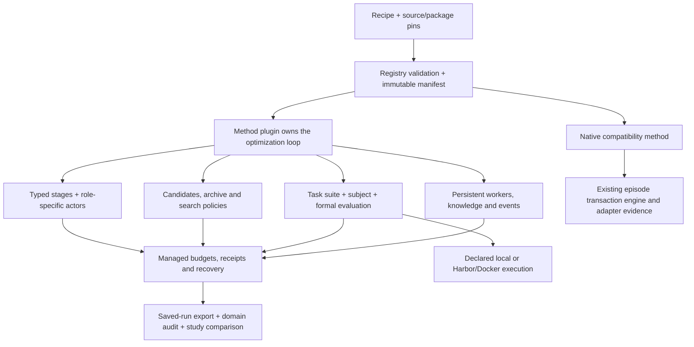

# Proteus 1.0 architecture and method coverage

Proteus is developing a shared framework for agent self-improvement research:
method recipes, reusable components, execution and evaluation services, and
inspectable experiment records. The initial scope covers GEPA, ACE, Meta-Harness,
Combee and CORAL, alongside the existing native evolution protocol.

For original papers, official repositories, exact upstream commits and citation
entries, see [method references](METHOD_REFERENCES.md) and [references.bib](../references.bib).

This describes the implementation in this source tree. **1.0 is not released.**
The five original-domain catalog entries are generic preparation templates and
retain `model_results_pending`; they do not identify a frozen model run. The
[October experiment recipes](../recipes/README.md) separately record all 15
accepted adapted single-seed profiles and the source/runtime differences.
Runnable fixtures and reference conformance checks establish mechanisms; they do
not establish reproduced paper scores, collaboration gains or recursive returns.
The [implementation plan](plans/proteus-1.0.0-implementation-plan.md) retains the
full experiment and release acceptance requirements.

## Architecture

| Layer | Responsibility and extension point | Details |
| --- | --- | --- |
| Recipe and registry | Validate options, ports and capabilities; bind plugin implementations, source/dependency versions and reference deviations | [Contracts](V1_CONTRACTS.md), [plugins](V1_PLUGINS.md) |
| Method | Own algorithm state, candidate proposals, evaluation schedule, stopping and final selection; use `Method.run(services, restored_state)` | [Public API](V1_PUBLIC_API.md) |
| Stage and actor | A stage transforms typed inputs into outputs; role-specific actors perform model or coding work. Fresh calls and confirmed native sessions are separate capabilities | [Stage templates](V1_PLUGIN_SCAFFOLDS.md), [coding workspaces](V1_CODING_WORKSPACES.md) |
| Artifact and search | Immutable text/record/file-tree candidates, explicit deltas and lineage; independent parent, archive and final policies over eligible score views | [Search](V1_SEARCH.md), [parent policy example](V1_PUBLIC_API.md) |
| Subject and evaluator | Execute the exact candidate on declared tasks/state; record predictions before allowed feedback; keep private references with the evaluator | [Evaluation contracts](V1_CONTRACTS.md), [code protocol](V1_CODE_PROTOCOL.md) |
| Parallel learning | Budgeted stage/workflow maps, ordered joins, Combee aggregation and measured batch control | [Workflows](V1_WORKFLOWS.md), [dynamic batches](V1_DYNAMIC_BATCHING.md) |
| Persistent research | Isolated worker identities/workspaces, explicit session continuity, formal evaluation gateway, versioned knowledge and event decisions | [Workers](V1_WORKERS.md), [gateway](V1_EVALUATION_GATEWAY.md), [knowledge](V1_SHARED_KNOWLEDGE.md), [events](V1_EVENT_POLICIES.md) |
| Execution | Declared local or pinned Harbor/Docker capabilities, candidate/source-build identity, separate verifier and verified cleanup | [Harbor trials](V1_HARBOR.md), [source builds](V1_SOURCE_BUILDS.md), [Harbor workers](V1_HARBOR_WORKERS.md) |
| Evidence and reports | Operation receipts, accounting and recovery; task scores, lineage, costs, timing, domain regrading and controlled/reference study summaries | [Recovery](V1_RECOVERY.md), [exports](V1_RESULT_EXPORT.md), [studies](V1_STUDY_COMPARISON.md) |

The optimizer actor and the subject being evaluated may use different models and
runtimes. A method is not required to use parent sampling, a scalar archive, or
the native observe/propose/act/reflect sequence. Its declared profile determines
which components it uses and which invariants its own state machine enforces.

## Included method profiles

These are bounded integration profiles, not a claim to implement every option or
published result of each upstream project. The individual documents pin source
revisions, original semantics and declared adaptations.

| Family | Included mechanism | Original-domain entry | Remaining result acceptance |
| --- | --- | --- | --- |
| [GEPA](V1_GEPA_METHOD.md) | Pinned upstream single-mutation loop; round-robin text components, full validation, instance frontier, no merge/cache | `gepa-aime`: [45/45/30 AIME study](V1_GEPA_AIME.md) | Real solver/reflection models, baseline and complete final split |
| [ACE](V1_ACE_METHOD.md) | Versioned playbook, generator/reflector/curator roles, counter/ADD updates, offline and online loops | `ace-formula`: [500/300/200 Formula study](V1_ACE_FORMULA.md) | Real models, baseline and complete offline/online protocol |
| [Meta-Harness](V1_META_HARNESS.md) | Historical code/evidence retrieval, multiple proposed files, memory learning, dataset/seed aggregation and frozen final selection | `meta-harness-mce`: three pinned MCE datasets with NoMemory/FewShotAll baselines | Real proposer and subject models over declared original-domain splits |
| Combee | Reusable aggregation in [ACE](V1_COMBEE_ACE.md) and [GEPA](V1_COMBEE_GEPA.md), parallel evaluations/workflows and fixed/dynamic batch control | `combee-formula`: [sequential ACE, naive parallel, fixed and dynamic Combee](V1_COMBEE_FORMULA.md) | Both combinations runnable; at least one real quality/cost/time comparison. The Formula common-condition profile is distinct from the paper's unresolved exact 250-example subset |
| [CORAL](V1_CORAL_METHOD.md) | One shared space, independent persistent workers, attempts/notes/skills, formal submissions and reflect/consolidate/pivot interventions | `coral-circle-packing`: [original 26-circle problem](V1_CORAL_CIRCLE_PACKING.md), one/two-worker recipes | Real worker models, matched declared budgets, sharing analysis and recovery evidence; final confirmation repeats the same problem |
| Native compatibility | Existing harness evolution, goals/no-goal, feedback visibility, snapshots and surface measurements | Existing native CLI and `proteus.native` recipe | Preserve adapter-specific recovery and live release gates; opaque native costs remain outside managed accounting |

Discover exact entry points and requirements with `proteus recipe catalog`.
Eight offline examples exercise the mechanisms without paid inference; five
benchmark preparation entries require explicit data, runtime, actor settings and
budgets. `recipe example` prepares the offline examples. It does not supply missing
benchmark settings or change a reference's validation status.

## Configuration versus a new plugin

| Research change | Route |
| --- | --- |
| Change a supported model, prompt, budget, seed, batch policy or method option | Change the recipe, validate capabilities, create a new lock and run |
| Swap an implemented parent/archive/final policy | Change its configured plugin; see the [configuration-only final-selector ablation](V1_RECIPE_CATALOG.md) |
| Add a self-evaluation step to a stage-composing method | Register a typed stage, connect its ports in the method configuration and declare how its evidence is consumed; see the [stage tutorial](V1_PLUGIN_SCAFFOLDS.md) |
| Introduce a new update rule, control loop or task interface | Implement the corresponding method/stage/policy/subject/evaluator plugin, with contract and recovery checks |
| Require a new sandbox, persistent session or external side effect | Add a runtime/service capability and its execution, accounting and recovery evidence |

Adding a stage definition does not automatically insert it into every method's
algorithm. A method must expose or explicitly invoke that stage. Self-assessment
is separate evidence; it does not automatically become the formal benchmark score.
Fixed model weights alone do not guarantee that a new method is expressible solely
through configuration. Reuse the common services and add the missing mechanism at
its extension boundary. Examples and templates use [the versioned API](V1_PUBLIC_API.md);
private journal files and worker transport internals are not stable plugin APIs.

## Budgets, isolation and measurements

Managed actors, subjects, graders, builds, evaluation reservations, parallel work
and worker generations retain attributable ledger records. Actual unknown usage
stays unknown; a reservation is not an observed bill. Unsupported finite limits
must be rejected rather than asserted for an opaque backend. The native
compatibility method retains its existing transaction/turn-budget engine and
[adapter input records](V1_NATIVE_INPUTS.md); these do not establish a complete
managed model-call/token/cost ledger for native episodes.

Local Python plugins and command workers are trusted processes. Visibility rules
control which evidence the framework supplies, but do not sandbox controller code.
Harbor/Docker supplies the declared container boundary. Its runtime fingerprint,
actual image, mounts and cleanup are verified; it is an execution backend, while
Proteus owns method state, artifact identities, evidence policy and experiment
aggregation. Trial, explicit sequence memory and persistent worker lifecycles are
separate capabilities, not interchangeable switches.

Summed operation time may overlap. Ledger calendar span may include pauses.
[Controller timing](V1_CONTROLLER_TIMING.md) measures uninterrupted invocation
intervals and leaves hard-exit gaps unknown. Background workers can remain active
while a controller is down, so its measured intervals do not establish total worker
active time. The Combee study's outer timer has its own documented boundary.

Use [CORAL cooperation reports](V1_CORAL_REPORT.md) for generation usage, formal
submissions and declared shared-knowledge sources. Available knowledge snapshots
are not proof of consumption or causal gain. [Circle-packing reports](V1_CORAL_CONTAINER_STUDY.md)
can independently regrade saved geometry. Other generic exports validate recorded
identities and aggregation without rerunning arbitrary evaluators. Existing native
surface/distance tools remain available for their supported artifacts and lineage;
their distances are not a universal quality metric across all methods.

## Start, extend and release

- Start with the [README recipe walkthrough](../README.md#recipe-quick-start), then
  choose a [catalog entry](V1_RECIPE_CATALOG.md) and its domain instructions.
- Generate an external method, stage, evaluator, subject or policy with
  [plugin scaffolds](V1_PLUGIN_SCAFFOLDS.md). Validate it outside the checkout.
- Export existing runs and compare explicit conditions with
  [StudySpec](V1_STUDY_COMPARISON.md). Private final scores require owner-side opt-in.
- Keep old runs in their original environment; follow
  [compatibility and migration boundaries](V1_COMPATIBILITY.md).
- Review the [unreleased 1.0 notes](releases/v1.0.0.md) and
  [release procedure](RELEASING.md). Feature PRs target `dev/1.0.0`; release
  acceptance precedes main integration, version changes, tags and publication.
